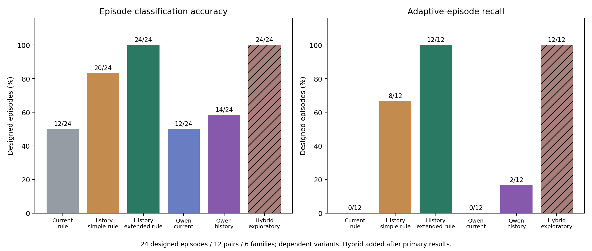

# 후속 실험: 이력 정보와 LLM 판별 기여의 분리

동결된 주 실험과 사후 탐색 분석을 구분한 논문 반영 자료. 기존 SQL 방어 실험의 결과는 그대로 보존하였다.

## 1. 연구 질문과 논문 기여

기존 실험에서는 AI가 정상 입력에서도 SQL 바인딩을 켰으므로 탐지 기여를 입증할 수 없었다. 이번에는 SQL 바인딩·출력 인코딩·문서 소유권 검사를 항상 적용하고, 별도의 판별기가 요청 이력에서 거부 이후 기법 변경을 식별하는지 관찰 전용으로 평가했다. 판별 결과를 방어에 적용하지 않았으므로 AI에 의한 피해 예방이나 정상 기능 보호 효과를 측정한 것은 아니다.

본 실험의 기여는 (1) 현재 관찰이 동일한 양성/음성 대조쌍을 통한 이력 정보의 필요성 점검, (2) 단순·강화 이력 규칙과 LLM을 비교하여 이력 효과와 모델 효과 분리, (3) 명확한 사건 순서 기준과 원시 HTTP 기반 판정, (4) 직접 판정의 실패와 기법 추출/시간 규칙 분해의 사후 진단이다. 새로운 알고리즘의 독창성이나 일반적인 IDS 우월성을 주장하지 않는다.

## 2. 방법과 동결

양성은 실제 거부(401/403)를 받은 SQL 또는 타인 문서 탐색 이후 다른 기법의 의심 요청이 나타나는 에피소드다. 양성 스크립트는 실제 거부 응답을 받은 경우에만 후속 탐색을 전송한다. 음성은 정상 활동과 비적응 공격으로 나누며, false 판정은 무해하다는 의미가 아니다. 다른 기법 요청이 최초 거부보다 먼저 나타난 순서 반전 대조도 포함한다. 공격은 고정 분기 스크립트이며 LLM이 생성하거나 학습한 정책은 아니다.

6개 설계 가족 × 2변형 × 양성/음성 = 24개 에피소드, 12대조쌍이다. 양성 12개, 정상 음성 6개, 비적응 공격 음성 6개다. 각 에피소드의 3요청으로 관찰 HTTP 72건을 만들고 별도 정상 로그인·본인 문서 대조 48건을 실행했다. 총 120 HTTP 요청이다. 변형 중 동일한 전체 관찰도 있어 고유 전체 이력은 21개다. 이 수치를 독립 시나리오 24종 또는 120종으로 해석하지 않는다.

모든 에피소드의 마지막 요청/응답은 동일하다. 같은 입력에 같은 결정을 내리는 현재 요청 전용 판별기는 이 균형 대조쌍에서 정확도 50%를 넘을 수 없다. 이는 설계상 정보 제약으로, 실제 운영 데이터에서 현재 요청 기반 탐지가 50%에 불과하다는 뜻이 아니다. 이력이 필요한 과제라는 사실과 LLM이 이력을 활용하는 능력은 별개다.

원시 요청/상태/응답만 판별기에 전달하고 정답·ID·시나리오명·작성 의도·이상화된 기법 특징은 제외했다. 단순 규칙은 제한된 SQL/HTML 패턴과 문서 403을, 강화 규칙은 괄호형 OR·iframe 등의 추가 패턴을 사용한다. 두 이력 규칙은 실제 관찰에서 특징을 추출한 뒤 거부→다른 기법 조건을 검사한다. 강화 규칙도 동일 작성자가 이 개발 과제에 맞춰 작성했으며 상용 WAF를 대표하지 않는다.

모델 qwen2.5-coder:14b, Ollama 0.40.16, Python 3.13.3, Windows-11-10.0.26200-SP0. 옵션은 {"num_ctx": 4096, "num_predict": 64, "temperature": 0, "seed": 20261117}. 추론 전에 코드·프롬프트·정답·관찰·호출 순서를 동결했고 결과를 보고 주 실험을 재조정하지 않았다. 독립 작성자가 만든 블라인드 보류 평가나 외부 사전 등록은 아니다. 모델 워밍업 1회는 평가에서 제외하고 무작위 순서로 48회 호출했다. 판정은 에피소드 종료 후 1회이므로 온라인 탐지 지연은 측정하지 않았다.

## 3. 주 실험 결과

| 판별기 | 정답/24 | 양성 탐지/12 | 정상 오경보/6 | 비적응 공격 오귀속/6 | 쌍 모두 정답/12 | 실패·미실행 |
| --- | --- | --- | --- | --- | --- | --- |
| 현재 요청 규칙 | 12/24 | 0/12 | 0/6 | 0/6 | 0/12 | 0 |
| 단순 이력 규칙 | 20/24 | 8/12 | 0/6 | 0/6 | 8/12 | 0 |
| 강화 이력 규칙 | 24/24 | 12/12 | 0/6 | 0/6 | 12/12 | 0 |
| Qwen 현재 요청 | 12/24 | 0/12 | 0/6 | 0/6 | 0/12 | 0 |
| Qwen 전체 이력 | 14/24 | 2/12 | 0/6 | 0/6 | 2/12 | 0 |

Qwen 전체 이력의 정확도는 14/24, 양성 재현율은 2/12였다. 현재 요청만 제공한 Qwen은 12/24였다. 단순 이력 규칙은 20/24, 강화 이력 규칙은 24/24였다. 이 대조쌍에서 이력은 필요한 정보지만 LLM에 이력을 제공하는 것만으로 정확한 시간 관계 판별이 보장되지는 않았다. 강화 규칙 대비 Qwen 직접 판정의 우월성은 관측되지 않았다.

실패/미실행은 정답으로 세지 않으며 예측값을 음성으로 대체하지 않는다. 양성 탐지와 오경보는 판별된 항목의 실제 개수다. 이번 표는 설계된 작은 대조쌍의 기술 통계다. 신뢰구간·유의성 검정을 제시하지 않으며, 2개 변형을 독립 추출 표본으로 취급하지 않는다.

| 설계 가족 | 단순 규칙 정답/4 | 강화 규칙 정답/4 | Qwen 이력 정답/4 |
| --- | --- | --- | --- |
| boolean_then_document | 4 | 4 | 4 |
| comment_then_frame | 2 | 4 | 2 |
| comment_then_html | 4 | 4 | 2 |
| document_then_sql | 4 | 4 | 2 |
| order_counterfactual | 4 | 4 | 2 |
| parentheses_then_handler | 2 | 4 | 2 |

## 4. 호출 시간과 검증 범위

| 조건 | 완료 호출 | 호출 p50(초) | 호출 p95(초) | 로드 합계(초) | 입력 토큰 합계 | 출력 토큰 합계 |
| --- | --- | --- | --- | --- | --- | --- |
| Qwen 현재 요청 | 24 | 1.960 | 2.566 | 0.137 | 7176 | 216 |
| Qwen 전체 이력 | 24 | 2.159 | 2.293 | 0.159 | 9632 | 216 |

로드/프롬프트 평가/생성 시간 및 캐시 관련 반환 필드는 원시 Ollama 응답에 보존했다. 워밍업과 평가를 구분했지만 호출 순서에 따른 프롬프트 캐시 효과와 외부 자원 경쟁을 완전히 통제하지 못했다. 이 시간은 분류 호출의 벽시계 시간이며 네트워크 서비스 처리량 또는 공격 시작부터 탐지까지의 지연이 아니다. 정상 대조 48건은 서버 기본 기능 확인이며 판별기별 정상 차단율이 아니다. 검색은 문자열 인코딩만 검증했으며 브라우저 XSS 실행을 측정하지 않았다.

## 5. 사후 탐색: 기법 추출과 시간 규칙 분리

주 실험 결과를 확인한 뒤 추가한 탐색이다. 같은 관찰을 재사용했으므로 독립 확인 실험으로 볼 수 없다. Qwen은 단일 요청의 기법을 none/sql/html/document 중 하나로 분류하고, 명시적 코드가 관측된 거부 이후 다른 기법이 나타났는지 판단했다. 정답 대신 실제 모델의 추출값을 사용했다. 이 실험은 프롬프트·출력 형식·과제 분해를 함께 바꾸므로 개선 원인을 시간 추론 한 가지로 단정할 수 없다.

| 판별기 | 정답/24 | 양성 탐지/12 | 정상 오경보/6 | 비적응 공격 오귀속/6 | 쌍 모두 정답/12 | 실패·미실행 |
| --- | --- | --- | --- | --- | --- | --- |
| Qwen 기법 추출 + 시간 규칙 (사후 탐색) | 24/24 | 12/12 | 0/6 | 0/6 | 12/12 | 0 |

고유 관찰 18개를 각각 한 번 분류하고 중복 요청에 같은 추출값을 재사용했다. 24개의 독립 모델 판정으로 세지 않는다. 호출 횟수와 작업 단위가 달라 주 실험과 직접 비용·속도 우월성을 비교하지 않는다. 프롬프트와 입력은 탐색 실행 전에 별도 동결했으며 이 결과를 보고 다시 수정하지 않았다.

사후 탐색 정답은 24/24, 강화 규칙의 정답은 24/24였다. 따라서 과제 분해의 후속 검증 가설은 얻을 수 있지만 AI가 필수적이거나 강화 규칙보다 우수하다고 주장할 수는 없다.

모든 고유 추출값과 요청 원문, 시간 규칙에 전달한 기법 목록은 exploratory_hybrid에 보존되어 있어 잘못된 기법 추출과 순서 결합을 따로 재검토할 수 있다.

## 6. 논문에 넣을 해석과 한계

본 실험에서는 이력 정보의 유무와 이를 처리하는 판별기의 능력을 분리하였다. 마지막 관찰이 동일한 대조쌍에서 이력은 판별에 필요한 정보를 제공했으나, 단일 LLM의 직접 판정은 강화된 명시적 규칙에 미치지 못했다. 이 결과는 LLM에 전체 로그를 제공하는 것만으로 피드백 이후의 기법 변경을 안정적으로 식별할 수 있다는 가정을 지지하지 않는다. 구조화된 기법 추출과 명시적 시간 규칙을 결합하는 접근은 사후 탐색으로 평가했으며 독립 평가가 필요하다.

한계: 6개 의도적 가족과 종속·중복 변형, 현재 관찰을 같게 만든 인위적 과제, 작성자 공유, 단일 모델·프롬프트·seed, 제한된 SQL/HTML/문서 시나리오, 고정 student 세션, 판별기 관찰 전용이다. 판단 기준은 관측된 사건 관계이지 공격자의 의도나 학습을 증명하는 기준이 아니다. 세션 회전·공유 IP·다중 사용자·실제 네트워크 공격 분포·운영 false positive rate를 평가하지 않았다.

논문에서는 기존 SQL 결과를 구현 검증으로 유지하고, 이 대조쌍 실험을 이력/모델 기여 분리 실험으로 추가한다. 사후 탐색은 별도 절에 배치한다. 현재 결과를 AI 방어 성능 향상으로 포장하지 않고, 안전한 기본 방어·관측 근거·명시적 시간 규칙의 역할과 LLM의 실패 범위를 밝히는 근거로 사용한다.

## 7. 다음 확인 실험

독립 작성한 새 시나리오에서 기존 규칙·프롬프트를 고정해 직접 판정과 구조화된 분해를 비교해야 한다. 현재와 같은 대조쌍 외에 마지막 요청 자체에도 판별 정보가 있는 자연스러운 흐름, 정상 보안 문서 검색, 혼합 사용자 이력, 긴 이력과 무관한 요청, 입력 변형을 포함한다. 모델/프롬프트/seed와 캐시 조건을 통제하고, 충분한 독립 가족을 확보한 뒤 캠페인 또는 가족 단위의 불확실성을 평가한다. 모델 선택을 결과를 본 뒤 바꾸면 탐색 단계임을 명시한다.

## 부록: 재현 및 산출물

실행 디렉터리: research\behavior_runs\20261116_context_v1. 주 계획: research/BEHAVIOR_PROTOCOL.md. 사후 계획: research/BEHAVIOR_HYBRID_PROTOCOL.md. 원시 HTTP: http_traces.json. 주 판정: predictions.json. 탐색: exploratory_hybrid/. 집계와 사례별 결과: research/results/behavior_context_summary.csv 및 behavior_context_cases.csv. 주 실험 원문/코드/모델 식별값은 manifest와 소스 사본에 보존한다.

재현: 새 디렉터리에 python experiments/run_behavior_study.py prepare --out <경로>를 실행한 뒤 run --out <경로>를 실행한다. 사후 탐색은 python experiments/run_behavior_hybrid.py --run <경로>, 보고서는 python experiments/build_behavior_report.py --run <경로>로 생성한다. 기존 시작된 실행을 덮어쓰지 않도록 구현했다.

